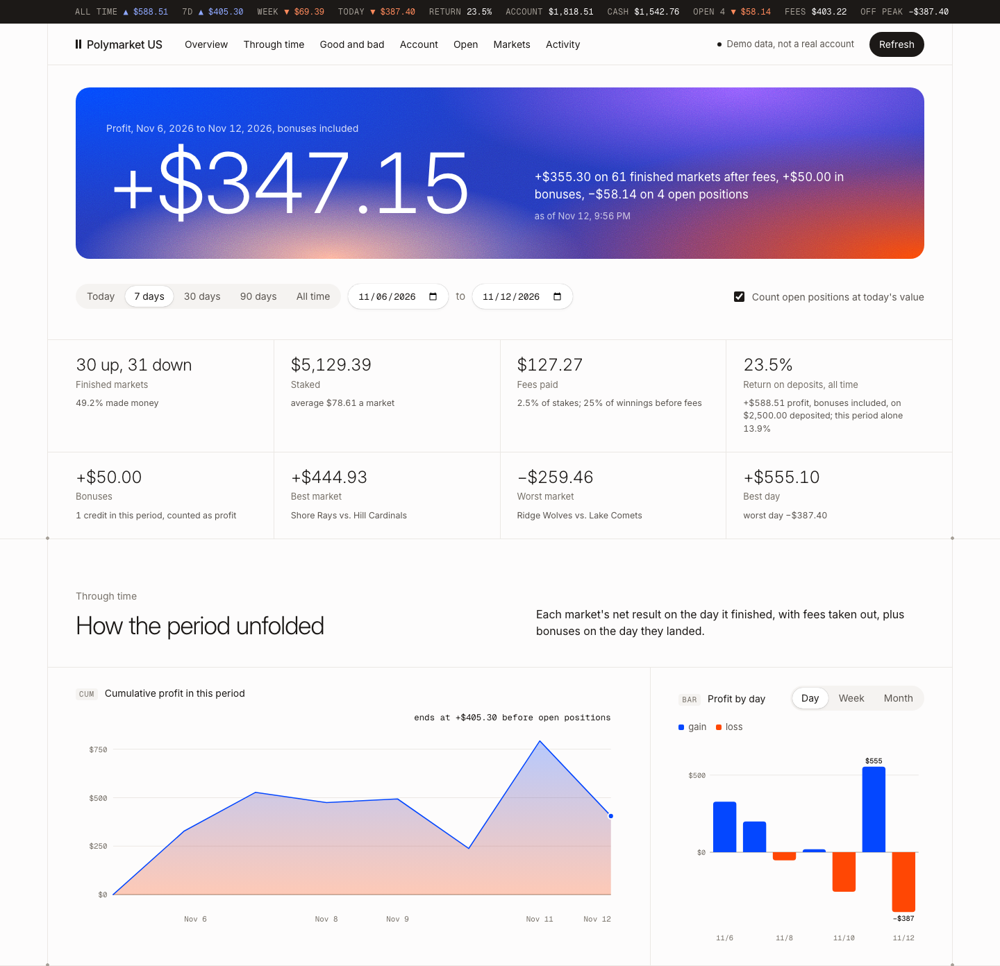
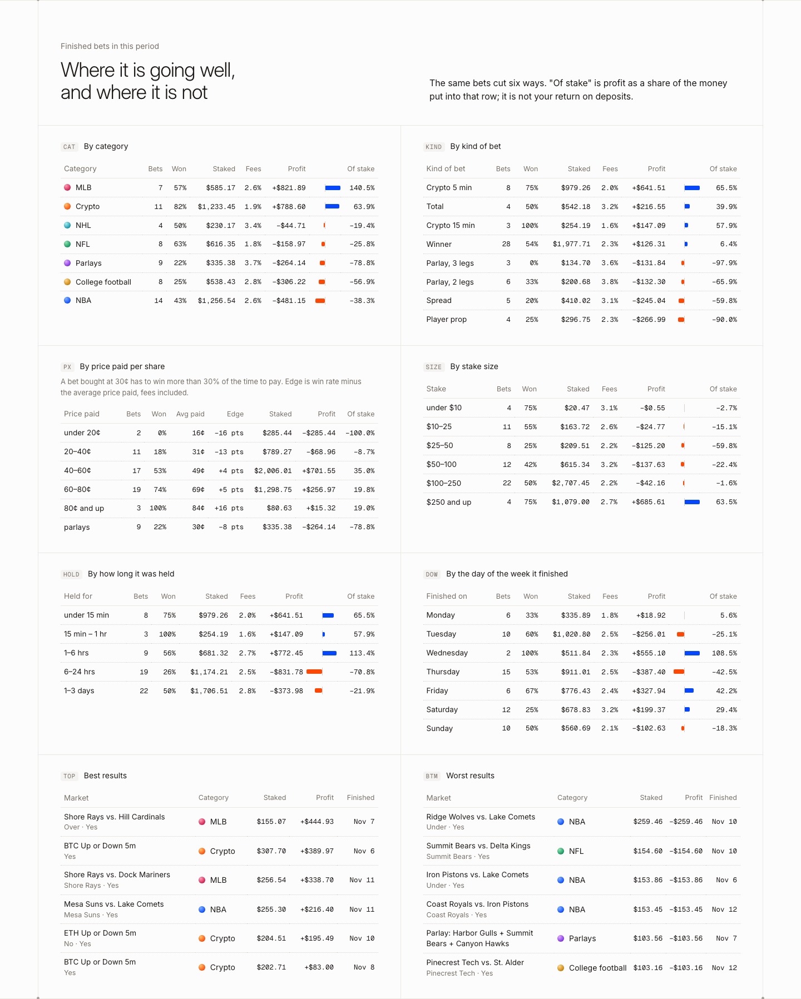
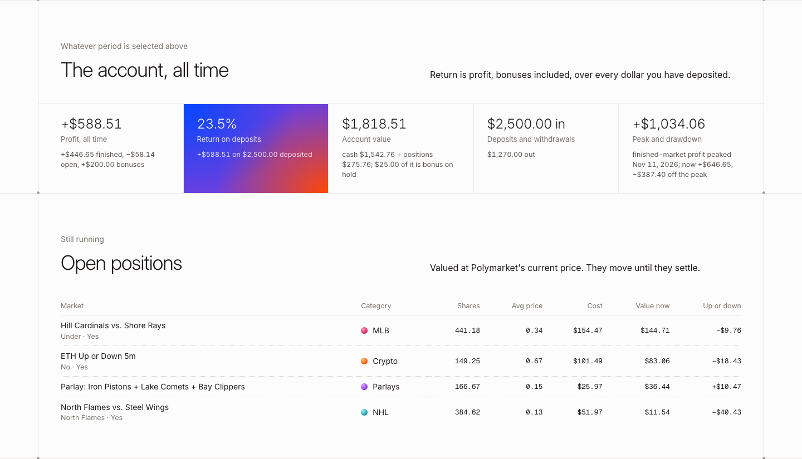
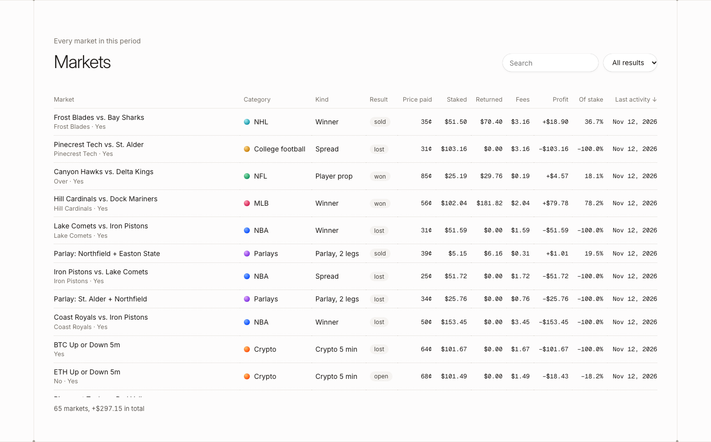

# Polymarket US profit and loss dashboard

A local, read-only dashboard for one [Polymarket US](https://polymarket.us) account. It answers two questions: how
much have I made or lost, and where is it going well or badly. It does not place, price or suggest bets.

Every screenshot below is made-up demo data (`./run.sh --demo`), not a real account.



## What it shows

- **Profit for any period**: today, 7, 30 or 90 days, all time, or your own dates. Bonuses count as profit. Open
  positions can be counted at today's value or left out.
- **Through time**: cumulative profit, and profit by day, week or month.
- **Where it is going well and badly**: the same finished bets broken down by category, kind of bet, price paid per
  share, stake size, how long they were held, and day of the week, plus the best and worst results.
- **The account, all time**: profit, return on deposits, account value, deposits and withdrawals, peak and drawdown.
- **Open positions, every market, and recent activity.**







## Try it without an account

Needs macOS or Linux and Python 3.10 or newer.

```sh
git clone https://github.com/stilwellc/polymarket-dashboard.git
cd polymarket-dashboard
python3 -m venv .venv
.venv/bin/pip install -r requirements.txt
./run.sh --demo
```

Open <http://127.0.0.1:8765>. Demo mode invents a consistent account history; it uses no credentials, makes no
network requests and writes no files.

## Set it up with your account

This part needs macOS, because credentials are kept in the macOS Keychain.

1. **Create an API key.** Sign in at [polymarket.us/developer](https://polymarket.us/developer) and create a key.
   You get a **Key ID** and a **Secret Key**. The secret is shown once.
2. **Install**, as in the demo steps above (clone, create the environment, install requirements).
3. **Store the key in the Keychain:**

   ```sh
   ./add_keys.sh
   ```

   Paste the Key ID at the "API key" prompt and the Secret Key at the "API secret" prompt. Press Enter to skip the
   address and passphrase prompts; Polymarket US does not use them. Input is hidden and is not written to any file
   or to shell history. Paste each value once: the prompt shows nothing, so a double paste is easy to miss.
4. **Run it:**

   ```sh
   ./run.sh
   ```

   Open <http://127.0.0.1:8765>.

Useful commands:

| Command | What it does |
|---|---|
| `./keys.sh list` | Shows which credentials are stored (names only, never values) |
| `./keys.sh delete` | Removes them from the Keychain |
| `.venv/bin/python -m pmdash --check` | Fetches once and prints the cash reconciliation and any warnings |
| `PMDASH_PORT=9000 ./run.sh` | Runs on another port |

Keyboard shortcuts on the page: `1`–`5` choose the period, `O` toggles open positions, `/` jumps to search, `R`
refreshes.

## Security

- **The key can trade.** Polymarket US keys are not read-only: the same key can place and cancel orders. This code
  only ever sends `GET` requests (`pmdash/client.py`), but treat the key like a password and revoke it at
  polymarket.us/developer if it is ever exposed.
- **Credentials stay in the Keychain** under the service name `polymarket-dashboard`. They are never written to the
  project folder.
- **The server is local only.** It binds to `127.0.0.1` and rejects requests whose `Host` header is anything else,
  so other devices and other websites cannot read your account through it.
- **Your history is cached on disk** in `data/raw.json`, readable only by you and ignored by git. Delete the `data/`
  folder to remove it.

## How profit is calculated

Profit is built from cash movements, so it has to agree with the cash Polymarket reports. The page says in its header
whether it does.

- A buy costs quantity × the price of your side, plus the fee. A sale returns quantity × price, minus the fee.
- A settlement pays $1 per share on the winning side and nothing on the losing side.
- A market's result is everything it returned minus everything it cost. It is booked on the day the market finished.
- Bonuses (referral and promotional credits) count as profit on the day they land.
- Open positions are valued at Polymarket's current price.
- Return on deposits is all-time profit divided by every completed deposit. Withdrawals are not netted off.
- Days, weeks and months are cut in your computer's time zone.

Polymarket's own "realized" fields are not used: they leave fees out of settlements and are missing on some sales.

The model refuses to compute from a partial history, and the page lists a warning for anything it could not account
for, such as an unrecognised credit type, a trade that does not add up, or a position missing from the open list.

## Files

| Path | Purpose |
|---|---|
| `pmdash/client.py` | Signs and sends read-only requests to the Polymarket US API |
| `pmdash/pnl.py` | Turns account activity into profit figures, with consistency checks |
| `pmdash/demo.py` | Invents account data for demo mode |
| `pmdash/__main__.py` | The local web server |
| `pmdash/index.html` | The page: period selection, charts and tables |
| `add_keys.sh`, `keys.sh`, `run.sh` | Store credentials, inspect or delete them, start the dashboard |

## Limits

- One account, one currency (USD).
- It refreshes when you press Refresh, not on a timer.
- Category and bet-kind labels cover the markets seen so far; unfamiliar ones fall back to Polymarket's raw names.
- Not affiliated with Polymarket. Not financial or tax advice.

Fonts in `pmdash/fonts/` are Inter and Geist Mono, both under the SIL Open Font License.
